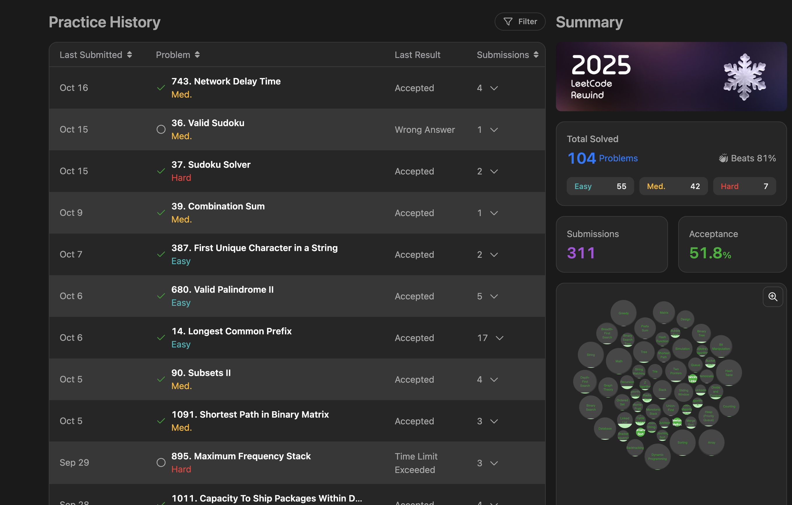
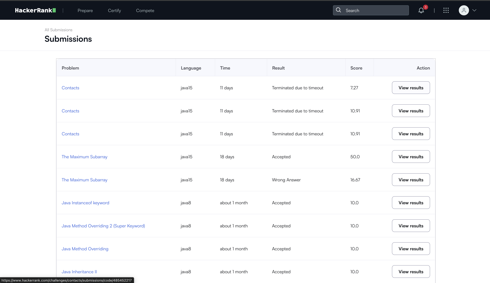

# Java Algorithms & Data Structures 🧠

Daily problem-solving practice covering Trees, Graphs, Dynamic Programming, and Sliding Window techniques using Java.

### 📊 Progress & Stats

**LeetCode Progress**

**HackerRank Progress**

### 💻 Solutions
*The Java source files for these solutions will be tracked and uploaded here.*
